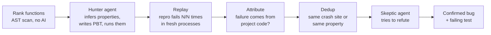

<div align="center">

# proofhound

**An AI bug hunter that only reports bugs it can prove.**

It reads your code, works out what each function promises, writes property-based tests,
and throws thousands of generated inputs at them. A failure only reaches you after it has
been shrunk to a minimal input, replayed as a deterministic test, traced to your code,
and survived an independent reviewer whose job is to refute it.

`npx proofhound`

**English** · [简体中文](README.zh-CN.md) · Python, JavaScript/TypeScript, Go, Rust & Java · MIT


</div>

## Why

AI code review tools are noisy. They guess, and you spend your afternoon checking whether
each guess is real. proofhound flips that around: the AI is only allowed to *propose*.
Execution decides.

Each step can only remove findings, never add them:

> hunter reports a failure → repro fails N/N times in fresh processes → failure traced to your code, not the test → duplicates merged → a skeptical reviewer cannot refute it → **you see it**


Every confirmed bug comes with a failing test you can commit, the minimal input, what was
expected and what happened, and the evidence that the behaviour is really promised.

## Quick start

```bash
cd your-project
npx proofhound                    # hunt in the 6 most promising modules
npx proofhound targets            # see what would be tested (no AI calls)
npx proofhound --only parse_url   # focus on a function, module or file
npx proofhound src/codec --budget 2
```

You need:

- **An agent CLI** that does the thinking: [Claude Code](https://claude.com/claude-code) (`claude`) or [Codex](https://github.com/openai/codex) (`codex`). proofhound drives it headlessly, so it uses the subscription or API key you already have.
- **Python projects:** `pip install pytest hypothesis` in the project's environment (proofhound uses `.venv/` automatically if it exists).
- **JS/TS projects:** Node 20+. fast-check and tsx are fetched into a cache on first run if your project does not have them.
- **Go projects:** Go 1.21+. [rapid](https://github.com/flyingmutant/rapid) is added to a private copy of your `go.mod`; your `go.mod`, `go.sum` and package directories are never written to.
- **Rust projects:** cargo. Tests run as integration tests of a separate harness crate that depends on yours by path, with [proptest](https://github.com/proptest-rs/proptest), so only your public API is exercised and your `Cargo.toml` is untouched.
- **Java projects:** JDK 21+. proofhound compiles your main sources into `.proofhound/` (never `target/` or `build/`), takes the dependency classpath from Maven or Gradle, and runs JUnit 5 with [QuickTheories](https://github.com/quicktheories/QuickTheories), both fetched into a cache on first run.

Run `npx proofhound doctor` to check everything.

## What you get

```
proofhound · Python · claude (sonnet) · 6 modules, 36 functions

  ▸ hunting in boltons/tbutils.py (from_string, from_dict, from_frame, …)
  ✓ TracebackInfo.from_dict does not rebuild Callpoint objects (crash, failed 3/3)
  ✓ format_histogram on empty Stats raises ZeroDivisionError (crash, failed 3/3)
  …
  reviewing 4 verified findings with an independent skeptic…
  bug (0.85) TracebackInfo.from_dict does not rebuild Callpoint objects

  ● PH-002 TracebackInfo.from_dict leaves frames as plain dicts instead of rebuilding Callpoint objects
    boltons.tbutils.TracebackInfo.from_dict · boltons/tbutils.py:323 · low, confidence 0.85
    input: d = TracebackInfo.from_traceback().to_dict()
    expected from_dict(d) round-trips, so to_dict() and str() work
    actual   AttributeError: 'dict' object has no attribute 'to_dict'
```

Each run writes `.proofhound/runs/<id>/`:

| File | What it is |
|---|---|
| `report.html` | The report above: funnel, confirmed bugs, and everything that was filtered out and why |
| `bugs/PH-001-…/BUG.md` | An issue-ready write-up: input, expected, actual, repro, evidence, review |
| `bugs/PH-001-…/<repro test>` | A standalone failing test (`test_repro_*.py`, `repro_*.test.mjs`, `repro_*_test.go` or `repro_*.rs`). Drop it into your suite, fix the bug, watch it pass |
| `results.json` | Everything, machine-readable |

The exit code is `1` when bugs were confirmed, so it can gate CI.

## How it works



1. **Rank.** A static scan (Python `ast`, Go `go/ast`, scanners for JS/TS, Rust and Java) lists public functions and methods and scores them by how checkable they are: documented, typed, pure, named like a transformation (`parse`, `encode`, `merge`, `normalize`…), with a bonus when an inverse exists (`encode`/`decode` means a round-trip property for free). Functions that touch the network, files, clocks or randomness rank low.
2. **Hunt.** For each module, a coding agent reads the source, docstrings, README and call sites, and writes property-based tests with [Hypothesis](https://hypothesis.works), [fast-check](https://fast-check.dev), [rapid](https://github.com/flyingmutant/rapid), [proptest](https://github.com/proptest-rs/proptest) or [QuickTheories](https://github.com/quicktheories/QuickTheories): round-trips, invariants, idempotence, agreement with a reference implementation, metamorphic relations. It runs them, separates its own mistakes from real failures, and writes a deterministic repro for each bug it believes in. The agent can only write inside `.proofhound/runs/` and can only run tests through proofhound's own runner.
3. **Replay.** proofhound, not the agent, re-runs every repro N times (default 3) in fresh processes. It is dropped if it ever passes, if the failure changes between runs, if it uses randomness or clocks, or if it cannot be loaded.
4. **Attribute.** The traceback is inspected. Errors raised inside the test itself (`NameError`, wrong call signatures, a `KeyError` in the test's own bookkeeping), errors from Hypothesis or fast-check, and errors from vendored code are test bugs, not your bugs. Crashes (including Go and Rust panics, read from goroutine traces and backtraces) are pinned to the deepest frame in your code, and an explicit `raise`/`throw`/`panic` is flagged so the reviewer can check whether it is documented behaviour.
5. **Dedup.** Findings with the same crash site, or the same property on the same function, are merged.
6. **Review.** A separate agent run, with a fresh context, gets the finding and the verified failure and is told that most automated reports are wrong. It checks whether the input is valid under the contract, whether the expected behaviour is really promised, whether the behaviour is intentional, and whether the test is correct. Only `bug` verdicts at or above `--min-confidence` (default 0.6) are confirmed; unsure ones are listed separately.

## Results so far

**Planted-bug fixtures** (`test/fixtures/`), Claude Sonnet:

| Fixture | Planted bugs | Found | False positives | Time | Cost |
|---|---|---|---|---|---|
| Python (`pylib`, 8 functions) | 5 | 5 | 0 (the documented-`ValueError` decoy was left alone) | 1m16s | $0.84 |
| JavaScript (`jslib`, 7 functions) | 3 | 2, plus 1 real one we had not planted | 0 (the documented-`RangeError` decoy was left alone) | 42s | $0.40 |
| Go (`golib`, 8 functions) | 5 | 5 | 0 (the documented-`panic` decoy was left alone) | 1m13s | $0.54 |
| Rust (`rustlib`, 7 functions) | 5 | 5 | 0 (the documented `Err` and `assert!` decoys were left alone) | 1m18s | $0.76 |
| Java (`javalib`, 9 functions) | 5 | 5 | 0 (the documented `IllegalArgumentException` and a correct `reverse` were left alone) | 1m27s | $0.51 |

**Real libraries:** 25 popular Python and JS libraries, 204 functions, about $9 in total: **20 confirmed bugs, 17 clear-cut and 3 debatable on a hand check, none wrong.** Then 15 Go and Rust libraries, 111 functions, about $5: **7 confirmed, 6 clear-cut and 1 debatable, none wrong**, for example `slug.Make("a")` returning `""` in gosimple/slug when smart truncation is off, and humantime's strict `parse_rfc3339` accepting `"1970-01-01T00:00:00ZZ"`. Full list with one-line repros in [SHOWCASE.md](SHOWCASE.md). Highlights (not yet reported upstream):

| Project | Modules | Confirmed | Example | Time | Cost |
|---|---|---|---|---|---|
| [boltons](https://github.com/mahmoud/boltons) (Python) | 6 | 4 | `TracebackInfo.from_dict` is documented as the complement of `to_dict` but never rebuilds `Callpoint` objects (the source has `# TODO: check this.`); `Stats([]).format_histogram()` divides by zero | 2m14s | $1.10 |
| [ms](https://github.com/vercel/ms) (TypeScript) | 1 | 1 | `format(-1500, { long: true })` returns `"-1 seconds"`, while `format(1500, { long: true })` returns `"2 seconds"` | 51s | $0.19 |
| [bytes](https://github.com/visionmedia/bytes.js) (JavaScript) | 1 | 0 | Two failures involving `-0` and float inputs were judged unspecified and not reported | 25s | $0.09 |

## Use it on pull requests (GitHub Action)

proofhound can check every pull request: it hunts only in the functions the PR changed, comments
on the PR when it can prove a bug (with the input, the expected and actual result, and a failing
test), and fails the check. Add `.github/workflows/proofhound.yml`:

```yaml
name: proofhound
on: pull_request

permissions:
  contents: read
  pull-requests: write   # to comment on the PR

jobs:
  hunt:
    runs-on: ubuntu-latest
    steps:
      - uses: actions/checkout@v4
        with:
          fetch-depth: 0   # needed to diff against the PR base
      # set up your project's toolchain as usual, for example:
      - uses: actions/setup-python@v5
        with: { python-version: '3.12' }
      - run: pip install -e . pytest hypothesis
      - uses: FengXiao1231/proofhound@v0
        with:
          anthropic-api-key: ${{ secrets.ANTHROPIC_API_KEY }}
          budget: 2
```

| Input | Default | |
|---|---|---|
| `anthropic-api-key` / `claude-code-oauth-token` | | One of them is required. The OAuth token (`claude setup-token`) uses a Claude subscription |
| `base` | the PR base | Ref to diff against; `none` hunts in the whole project |
| `model` | `sonnet` | Model for the hunter and the reviewer |
| `budget` | `2` | Stop starting new work after this many dollars |
| `max-modules` | `4` | Most files to hunt in |
| `comment` | `bugs` | `always`, `bugs` (comment only when bugs are found; an earlier comment is still updated) or `never` |
| `fail-on-bugs` | `true` | Fail the check when a bug is confirmed |
| `working-directory` | `.` | Project directory inside the repository |
| `args` | | Extra options, e.g. `--lang go --notes "..."` |

The HTML report, `results.json` and the repro tests are uploaded as the `proofhound-report` artifact, and the summary is shown on the run page. Pull requests from forks get no secrets on `pull_request`, so the action fails with a clear message there. Do not switch to `pull_request_target` to work around it: that would run the fork's code with your secrets.

The same diff mode works locally: `npx proofhound --diff main`.

## Options

```
proofhound [paths...]            hunt for bugs (default: the current directory)
proofhound targets [paths...]    show which functions would be tested, no AI calls
proofhound report                rebuild the HTML report for the latest run
proofhound doctor                check that the toolchain is ready

--lang <python|js|go|rust|java>  language (auto-detected)
--agent <claude|codex>    which coding-agent CLI does the thinking (auto-detected)
--model <name>            model for the hunter, e.g. sonnet, opus
--review-model <name>     model for the reviewer (defaults to --model)
--only <names>            comma-separated functions, modules or files to focus on
--max-modules <n>         how many modules to hunt in (default 6)
--per-module <n>          functions per module (default 6)
-j, --jobs <n>            modules hunted in parallel (default 2)
--runs <n>                times each repro must fail to count (default 3)
--budget <usd>            stop starting new work after spending this much
--min-confidence <0-1>    reviewer confidence needed to confirm (default 0.6)
--no-review               skip the independent review step
--notes <text>            extra context for the hunter (contracts, known quirks)
--diff [ref]              only hunt in functions changed since ref (default: the PR base in CI, else origin's default branch)
--summary-file <path>     also write a Markdown summary (for PR comments and CI)
--json                    print results as JSON on stdout
```

Optional `.proofhound/config.json`:

```json
{
  "python": ".venv/bin/python",
  "notes": "Timestamps are always UTC. parse_* functions may raise ParseError on bad input; that is intended.",
  "env": { "MYAPP_SETTINGS": "test" },
  "maxExamples": 300,
  "testTimeoutSec": 120,
  "agentTimeoutSec": 1200
}
```

`notes` is the best lever you have: tell the hunter what your contracts are and the false-positive rate drops further.

## Safety

The hunter agent runs with a strict allowlist: read files, write only inside
`.proofhound/runs/<id>/`, and run only `./.proofhound/ph-test`. It has no network tools.
The tests it writes do execute your code, though, just like your own test suite does. On
code you do not trust, run proofhound inside a container.

## Cost

A module costs roughly $0.15–0.35 with Claude Sonnet, including review. Use `--budget` to
cap a run, `--only` to aim it, and a cheaper `--review-model` if you like.

## Roadmap

- `--fix`: propose a patch, accept it only if the repro passes and the existing suite stays green
- Kotlin

## Credits

The idea that agents can mine properties and find real bugs with property-based testing
comes from Anthropic's research, [*Finding bugs with agentic property-based testing*](https://www.anthropic.com/research/property-based-testing),
and its Python prototype [agentic-pbt](https://github.com/mmaaz-git/agentic-pbt).
proofhound turns it into a tool for five languages with execution-based verification,
attribution, deduplication and adversarial review.

## License

MIT
