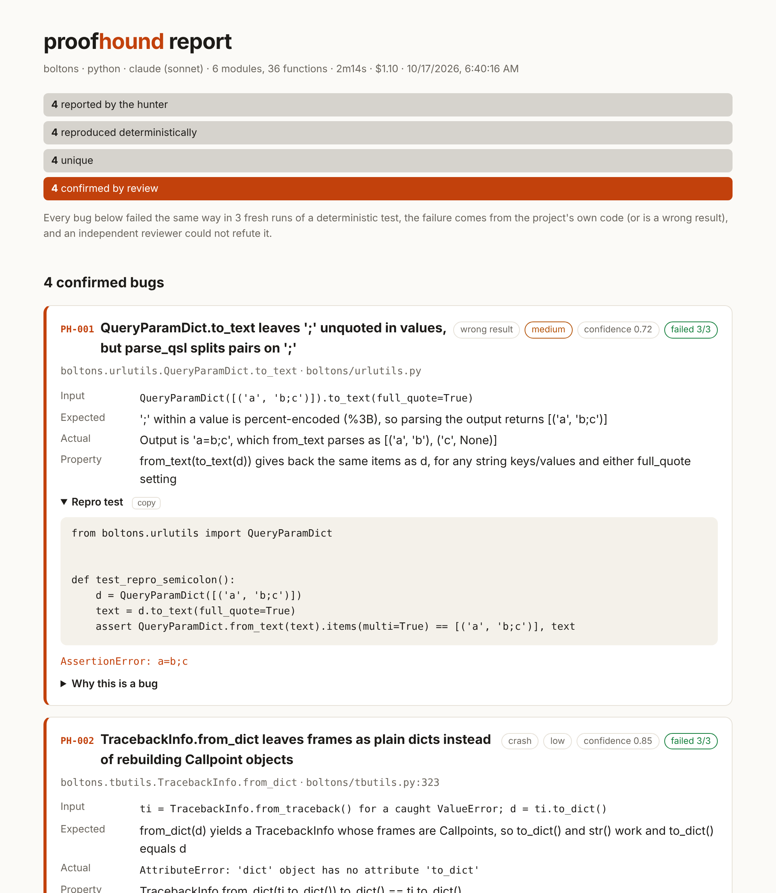
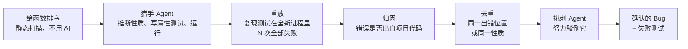

<div align="center">

# proofhound

**只报告能证明的 Bug 的 AI 找 Bug 工具。**

它会读你的代码，推断每个函数承诺了什么，写成属性测试，再用成千上万个自动生成的输入去打。
一个失败要先被缩到最小输入、重放成确定性测试、定位到你的代码、再扛住一个专门挑刺的独立复核，
才会出现在你面前。

`npx proofhound`

[](https://github.com/FengXiao1231/proofhound/actions/workflows/test.yml)
[](package.json)
[](package.json)
[](LICENSE)

[English](README.md) · **简体中文** · 支持 Python、JavaScript/TypeScript、Go、Rust 和 Java · MIT



</div>

## 为什么做这个

现在的 AI 代码审查误报太多。它靠猜，你得花一下午去核实每条猜测是不是真的。
proofhound 反过来：AI 只负责**提出**怀疑，由**实际运行**来裁决。

每一步只会删掉发现，不会增加：

> AI 报告一个失败 → 复现测试在全新进程里 N 次全部失败 → 错误确实出自你的代码而不是测试 → 合并重复 → 挑刺的复核者驳不倒 → **你才会看到**

每个确认的 Bug 都附带一个可以直接提交的失败测试、最小输入、期望结果和实际结果，以及"这确实是承诺过的行为"的证据。

## 快速开始

```bash
cd your-project
npx proofhound                    # 在最值得测的 6 个模块里找 Bug
npx proofhound targets            # 只看会测哪些函数，不调用 AI
npx proofhound --only parse_url   # 聚焦某个函数、模块或文件
npx proofhound src/codec --budget 2
npx proofhound --api              # 改为测 HTTP API（FastAPI、Flask、Express、Fastify）而不是函数
```

需要：

- **一个 AI 编程命令行工具**负责思考：[Claude Code](https://claude.com/claude-code)（`claude`）或 [Codex](https://github.com/openai/codex)（`codex`）。proofhound 以无界面模式驱动它，用的是你已有的订阅或 API Key。
- **Python 项目**：在项目环境里 `pip install pytest hypothesis`（如果有 `.venv/` 会自动使用）。
- **JS/TS 项目**：Node 20+。如果项目里没有 fast-check 和 tsx，首次运行会自动装到缓存目录。
- **Go 项目**：Go 1.21+。[rapid](https://github.com/flyingmutant/rapid) 会加到你 `go.mod` 的一份私有副本里，你的 `go.mod`、`go.sum` 和包目录都不会被写入。
- **Rust 项目**：cargo。测试作为一个独立 harness crate 的集成测试运行，它按路径依赖你的 crate 并使用 [proptest](https://github.com/proptest-rs/proptest)，所以只会测到公开 API，你的 `Cargo.toml` 不会被改动。
- **Java 项目**：JDK 21+。proofhound 把你的主代码编译到 `.proofhound/` 里（不会写入 `target/` 或 `build/`），从 Maven 或 Gradle 取依赖的 classpath，用 JUnit 5 加 [QuickTheories](https://github.com/quicktheories/QuickTheories) 跑测试，两者首次运行时自动下载到缓存目录。

运行 `npx proofhound doctor` 检查环境。

## 输出什么

每次运行会生成 `.proofhound/runs/<id>/`：

| 文件 | 内容 |
|---|---|
| `report.html` | 上图的报告：漏斗、确认的 Bug，以及所有被过滤掉的发现和原因 |
| `bugs/PH-001-…/BUG.md` | 可以直接贴成 issue 的说明：输入、期望、实际、复现代码、证据、复核意见 |
| `bugs/PH-001-…/fix.patch` | 加 `--fix` 时生成：让复现测试通过、又不破坏你原有测试的补丁，用 `git apply` 应用 |
| `bugs/PH-001-…/<复现测试>` | 独立的失败测试（`test_repro_*.py`、`repro_*.test.mjs`、`repro_*_test.go` 或 `repro_*.rs`）。放进你的测试集，修好 Bug，看它变绿 |
| `results.json` | 全部数据，方便程序读取 |

确认到 Bug 时退出码为 `1`，可以直接用来卡 CI。

## 工作原理



1. **排序**。静态扫描（Python 用 `ast`，Go 用 `go/ast`，JS/TS、Rust 和 Java 用扫描器）列出公开函数和方法，按"好不好验证"打分：有文档、有类型、无副作用、名字像变换（`parse`、`encode`、`merge`、`normalize`……），如果存在逆函数还会加分（有 `encode`/`decode` 就天然有往返性质）。会碰网络、文件、时钟、随机数的函数排在后面。公开方法会改变自身状态的类（购物车、账户、缓存、带游标的解析器）在 Python 和 JavaScript 里会被当作一个整体目标：它的 `add`/`remove`/`update` 单独看都是很差的目标，合在一起却是最好的那种。加 `--api` 时目标换成 FastAPI、Flask、Express、Fastify、Koa 或 Hono 应用的路由（装饰器、带前缀的 router 和 blueprint、app 工厂），按契约和有没有配对的路由（POST 配 GET、PUT、列表接口）排名。
2. **猎捕**。每个模块交给一个编程 Agent：读源码、文档字符串、README 和调用处，用 [Hypothesis](https://hypothesis.works)、[fast-check](https://fast-check.dev)、[rapid](https://github.com/flyingmutant/rapid)、[proptest](https://github.com/proptest-rs/proptest) 或 [QuickTheories](https://github.com/quicktheories/QuickTheories) 写属性测试，比如往返、不变量、幂等、和参考实现对照、蜕变关系。对有状态的类，它写的是基于模型的测试（`hypothesis.stateful`、`fc.commands`）：随机生成一串方法调用，对照一个简单模型，每一步之后检查查询方法承诺的性质，所以复现就是一小段调用序列。测 HTTP API 时它在进程内驱动应用（FastAPI 的 `TestClient`、Flask 的 test client、Fastify 的 `inject`，Express 则起一个回环端口的服务），检查契约：合法输入不出 5xx 和未捕获异常、响应体符合声明的 response model 或 OpenAPI schema、创建后能读回、PUT 幂等、DELETE 之后 404、分页每条恰好出现一次。handler 里抛出的异常和其他崩溃一样定位到那一行。它还会被告知项目自己的测试里定义了哪些 fixture、工厂和辅助函数（`conftest.py`、`factories.py`、`test/helpers.*`），用它们来构造合法的用户、订单、会话，而不是自己瞎猜；`tests/conftest.py` 也会为它的测试加载。它会运行测试，分清是自己写错了还是真失败，并为它相信的每个 Bug 写一个确定性的复现测试。Agent 只能在 `.proofhound/runs/` 里写文件，只能通过 proofhound 自己的测试运行器跑测试。
3. **重放**。由 proofhound（不是 Agent）把每个复现测试在全新进程里重跑 N 次（默认 3 次）。只要有一次通过、失败原因前后不一致、用了随机数或时钟、或者根本加载不了，就丢弃。
4. **归因**。检查调用栈。测试自身抛出的错误（`NameError`、参数传错、测试自己算错导致的 `KeyError`）、Hypothesis/fast-check 的错误、第三方库内部的错误，都算测试的问题，不算你的 Bug。崩溃（包括从 goroutine 调用栈和 Rust backtrace 里读出的 panic）会定位到你代码里最深的那一帧；如果是显式的 `raise`/`throw`/`panic` 会单独标出来，让复核者判断是不是文档里写明的行为。
5. **去重**。出错位置相同、或同一函数上同一性质的发现会被合并。
6. **复核**。另起一次全新上下文的 Agent 调用，拿到发现和已验证的失败，并被告知"大多数自动报告都是错的"。它要检查：输入是否符合函数约定、期望行为是否真的被承诺、这个行为是不是故意的、测试本身对不对。只有判为 `bug` 且置信度不低于 `--min-confidence`（默认 0.6）的才算确认；拿不准的单独列出。默认复核用的是和猎手相同的模型，只是新开一个上下文；传 `--review-model`（比如 `opus`）可以换一个更强的模型来挑刺。
7. **修复（可选，`--fix`）**。对每个确认的 Bug，Agent 在项目的一次性副本里改代码（副本放在系统临时目录，不在项目里）。只有当复现测试的全新副本能通过、并且项目自己的测试（`pytest`、`npm test`、`go test ./...`、`cargo test`、`mvn test` / `gradle test`，或配置里的 `testCommand`）没有从通过变成失败时，proofhound 才保留这个补丁。你的工作目录始终不会被改动。

## 目前的成绩

**埋了 Bug 的示例库**（`test/fixtures/`，Claude Sonnet）：

| 示例 | 埋的 Bug | 找到 | 误报 | 用时 | 花费 |
|---|---|---|---|---|---|
| Python（`pylib`，8 个函数） | 5 | 5 | 0（文档写明会抛 `ValueError` 的诱饵没被误报） | 1分16秒 | $0.84 |
| JavaScript（`jslib`，7 个函数） | 3 | 2，外加 1 个我们没埋但确实存在的 | 0（文档写明会抛 `RangeError` 的诱饵没被误报） | 42秒 | $0.40 |
| Go（`golib`，8 个函数） | 5 | 5 | 0（文档写明会 `panic` 的诱饵没被误报） | 1分13秒 | $0.54 |
| Rust（`rustlib`，7 个函数） | 5 | 5 | 0（文档写明返回 `Err` 和会 `assert!` 的诱饵没被误报） | 1分18秒 | $0.76 |
| Java（`javalib`，9 个函数） | 5 | 5 | 0（文档写明会抛 `IllegalArgumentException` 的诱饵和本来就正确的 `reverse` 都没被误报） | 1分27秒 | $0.51 |

**真实开源库**：25 个常用 Python 和 JS 库、204 个函数，总花费约 $9，**确认 20 个 Bug；人工逐个复核后，17 个是明确的 Bug，3 个有争议，没有一个是错的**。之后又跑了 15 个 Go 和 Rust 库、111 个函数，花费约 $5，**确认 7 个，6 个明确、1 个有争议，没有错的**，比如 gosimple/slug 关闭智能截断后 `slug.Make("a")` 返回 `""`，humantime 的严格解析函数 `parse_rfc3339` 接受 `"1970-01-01T00:00:00ZZ"`。之后又用 `--fix` 跑了 5 种语言的 41 个库、309 个函数，花费约 $15，**确认 26 个，19 个明确、7 个有争议，没有错的；写出 17 个补丁，17 个全部通过验证**，比如 jsemver 的 `nextPreReleaseVersion()` 把 `1.0.0-alpha.0` 变成 `1.0.0-alpha.0.1`，补丁只改了一行。之后又在 12 个 API 是有状态的类的库（缓存、有序集合、队列、状态机）上以状态机方式测试，93 个函数，约 $3：**确认 6 个，6 个都明确，没有错的**，比如 `denque` 的 `removeOne(-1)` 会把队列弄坏，`ordered-set` 的 `pop(index)` 之后 `index()` 返回错的位置。再之后用 `--api` 测了 5 个小型 Web 应用（Flask、FastAPI、Express 风格的路由），39 个路由，约 $2：**确认 5 个，5 个都是真的，没有错的，另有 1 个被审阅者撤回，因为项目自己的测试就要求那个行为**，比如 json-server 的 `GET /constructor` 会沿 `Object.prototype` 找到东西，`PUT /toString` 会往数据库里写入一个新键。它还在自己的源码里找出 7 个 Bug，都已修好。完整清单和一行复现代码见 [SHOWCASE.md](SHOWCASE.md)。部分例子（还没向上游报告）：

| 项目 | 模块数 | 确认 | 例子 | 用时 | 花费 |
|---|---|---|---|---|---|
| [boltons](https://github.com/mahmoud/boltons)（Python） | 6 | 4 | `TracebackInfo.from_dict` 文档说它是 `to_dict` 的逆操作，但从不重建 `Callpoint` 对象（源码里写着 `# TODO: check this.`）；`Stats([]).format_histogram()` 会除以零 | 2分14秒 | $1.10 |
| [ms](https://github.com/vercel/ms)（TypeScript） | 1 | 1 | `format(-1500, { long: true })` 返回 `"-1 seconds"`，而 `format(1500, { long: true })` 返回 `"2 seconds"` | 51秒 | $0.19 |
| [bytes](https://github.com/visionmedia/bytes.js)（JavaScript） | 1 | 0 | 两个涉及 `-0` 和浮点输入的失败被判定为约定未覆盖，没有上报 | 25秒 | $0.09 |

## 在 PR 上自动运行（GitHub Action）

proofhound 可以检查每一个 PR：只在这个 PR 改动过的函数里找 Bug。证明有 Bug 时，它会在 PR 下面留评论，写明输入、期望结果、实际结果，并附上失败测试，同时把这次检查标为失败。添加 `.github/workflows/proofhound.yml`：

```yaml
name: proofhound
on: pull_request

permissions:
  contents: read
  pull-requests: write   # 用来在 PR 下评论

jobs:
  hunt:
    runs-on: ubuntu-latest
    steps:
      - uses: actions/checkout@v4
        with:
          fetch-depth: 0   # 需要完整历史，才能和 PR 的基准分支做对比
      # 按平常的方式装好项目的工具链，例如：
      - uses: actions/setup-python@v5
        with: { python-version: '3.12' }
      - run: pip install -e . pytest hypothesis
      - uses: FengXiao1231/proofhound@v0
        with:
          anthropic-api-key: ${{ secrets.ANTHROPIC_API_KEY }}
          budget: 2
```

| 参数 | 默认值 | 说明 |
|---|---|---|
| `anthropic-api-key` / `claude-code-oauth-token` | | 二选一，必填。OAuth token（用 `claude setup-token` 获取）走 Claude 订阅额度 |
| `base` | PR 的基准提交 | 和哪个提交对比；填 `none` 则检查整个项目 |
| `model` | `sonnet` | 猎手和复核用的模型 |
| `budget` | `2` | 花到这么多美元就不再开始新任务 |
| `max-modules` | `4` | 最多检查几个文件 |
| `comment` | `bugs` | `always`、`bugs`（只在找到 Bug 时评论；之前的评论仍会更新）或 `never` |
| `fix` | `false` | 同时为每个确认的 Bug 给出经过验证的补丁，并放进评论里 |
| `fail-on-bugs` | `true` | 确认到 Bug 时让检查失败 |
| `working-directory` | `.` | 项目在仓库里的目录 |
| `args` | | 额外参数，比如 `--lang go --notes "..."` |

HTML 报告、`results.json` 和复现测试会作为 `proofhound-report` 产物上传，摘要显示在运行页面上。来自 fork 的 PR 在 `pull_request` 事件下拿不到 secrets，这时 Action 会给出明确的报错。不要为了绕过它改用 `pull_request_target`，那样会带着你的 secrets 去运行 fork 里的代码。

同样的 diff 模式在本地也能用：`npx proofhound --diff main`。

## 参数

```
proofhound [paths...]            找 Bug（默认当前目录）
proofhound targets [paths...]    显示会测试哪些函数，不调用 AI
proofhound report                重新生成最近一次运行的 HTML 报告
proofhound doctor                检查工具链

--lang <python|js|go|rust|java>  语言（自动识别）
--agent <claude|codex>    用哪个 AI 命令行工具（自动识别）
--model <name>            猎手用的模型，如 sonnet、opus
--review-model <name>     复核用的模型（默认同 --model）
--api                     测 HTTP API（FastAPI、Flask、Express、Fastify 的路由）而不是函数
--only <names>            逗号分隔的函数、模块或文件
--max-modules <n>         最多猎捕几个模块（默认 6）
--per-module <n>          每个模块最多几个函数（默认 6）
-j, --jobs <n>            并行模块数（默认 2）
--runs <n>                复现测试需要连续失败几次（默认 3）
--budget <usd>            花到这个数就不再开始新任务
--min-confidence <0-1>    复核置信度门槛（默认 0.6）
--no-review               跳过独立复核
--notes <text>            给猎手的额外背景（约定、已知特性）
--diff [ref]              只检查自 ref 以来改动过的函数（默认：CI 里是 PR 的基准分支，否则是 origin 的默认分支）
--summary-file <path>     另外输出一份 Markdown 摘要（用于 PR 评论和 CI）
--fix                     同时为每个确认的 Bug 写补丁，只有复现测试通过且项目原有测试仍通过才保留
--fix-budget <usd>        在 --budget 之外留给修复的额度（默认是 --budget 的一半）
--json                    在标准输出打印 JSON 结果
```

可选的 `.proofhound/config.json`：

```json
{
  "python": ".venv/bin/python",
  "notes": "时间戳一律是 UTC。parse_* 函数遇到坏输入会抛 ParseError，这是故意的。",
  "env": { "MYAPP_SETTINGS": "test" },
  "maxExamples": 300,
  "testTimeoutSec": 120,
  "agentTimeoutSec": 1200
}
```

`notes` 是最有效的调节手段：告诉猎手你的约定是什么，误报会进一步减少。

## 安全

用 Claude Code 时，猎手 Agent 在严格白名单下运行：可以读文件，只能在 `.proofhound/runs/<id>/` 里写，只能运行 `./.proofhound/ph-test`，没有联网工具。
用 Codex 时，复核 Agent 在它的只读沙箱里运行，但猎手 Agent 运行在 Codex 的 `workspace-write` 沙箱里，这个沙箱没有按工具划分的白名单：它可以写项目里的任何文件、运行任何命令（proofhound 会在这种情况下打印一条提示）。
无论哪种，Agent 写的测试都会执行你的代码，就像你自己的测试集一样。对不信任的代码，请在容器里运行 proofhound。加 `--fix` 时，修复 Agent 只能在它自己的临时项目副本里写文件；改动或删除了项目现有测试的补丁会被拒绝，补丁只展示给你，不会自动应用。

proofhound 生成的所有东西都在 `.proofhound/` 里，里面自带一个 `.gitignore`，把运行记录、Go / Rust / Java 的构建缓存和报告全部忽略，只保留你自己的 `config.json`。

## 花费

用 Claude Sonnet 每个模块大约 $0.15–0.35（含复核）。可以用 `--budget` 封顶，用 `--only` 缩小范围，或给 `--review-model` 换个便宜的模型。

## 路线图

- Go、Rust、Java 也支持有状态（基于模型）的测试和 fixture 复用，和现在的 Python、JavaScript 一样
- HTTP API：Django REST framework 和 NestJS 的路由；只有 OpenAPI、只能走网络访问的应用
- `proofhound fix`：对已有的运行结果直接补写补丁，不用重新找 Bug
- Kotlin

## 致谢

"Agent 可以挖掘性质、用属性测试找到真实 Bug"这个想法来自 Anthropic 的研究
[*Finding bugs with agentic property-based testing*](https://www.anthropic.com/research/property-based-testing)
及其 Python 原型 [agentic-pbt](https://github.com/mmaaz-git/agentic-pbt)。
proofhound 把它做成了支持五种语言的工具，并加上了基于执行的验证、归因、去重和对抗式复核。

## 许可证

MIT
